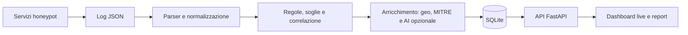

<div align="center">

# HoneypotX

### Dai log degli honeypot a una storia leggibile dell’attacco.

Piattaforma di osservazione multi-protocollo con dashboard live, correlazione degli eventi,
valutazione del rischio, mapping MITRE ATT&CK e analisi AI opzionale.

**SSH · Telnet · HTTP/HTTPS · FTP · MySQL · SMB · Modbus/TCP · S7comm**

[Come funziona](#come-funziona) · [Installazione](#installazione) · [Dashboard](#dashboard) · [Documentazione](#documentazione)

</div>

---

## Il progetto

HoneypotX raccoglie le interazioni ricevute da servizi esca e le trasforma in incidenti
consultabili da un’unica interfaccia. Permette di osservare quali servizi vengono sondati,
quali credenziali vengono provate e quali comandi vengono eseguiti nelle sessioni consentite
dall’honeypot.

Il progetto unisce **Cowrie**, **OpenCanary** e servizi Python personalizzati per FTP,
MySQL, SMB e protocolli industriali. Il backend legge i loro log, normalizza i dati,
applica regole e soglie, correla le attività e conserva le evidenze in SQLite.
La dashboard consente poi di esplorare incidenti, indirizzi IP, timeline e report.

È pensato per laboratori di cybersecurity, studio dei protocolli e osservazione di
interazioni con ambienti esca. Gli incidenti derivano dai log ricevuti: un allarme descrive
un comportamento osservato e non dimostra, da solo, la compromissione di un sistema reale.

## Funzionalità principali

| Funzione | Cosa offre |
|---|---|
| **Raccolta multi-protocollo** | Un formato comune per i log di servizi diversi, con sessioni, porte e credenziali quando disponibili. |
| **Rilevamento e soglie** | Classificazione delle richieste e correlazione dei tentativi ripetuti in finestre temporali configurabili. |
| **Valutazione del rischio** | Punteggio da 0 a 100, severità e spiegazioni in italiano per aiutare il triage. |
| **MITRE ATT&CK** | Tecniche e sotto-tecniche con confidenza esplicita; dettaglio delle attività Discovery nei comandi. |
| **Correlazione** | Storyline per IP/sessione, timeline e collegamenti tra più incidenti. |
| **Dashboard live** | Tabella eventi, mappa, grafici, filtri, dettaglio incidente e profilo IP. |
| **Analisi AI opzionale** | Interpretazione del comportamento e consigli contestuali tramite Claude Haiku. |
| **Report** | Esportazione HTML e JSON dei dettagli di un incidente o di un indirizzo IP. |
| **Sensore port scan opzionale** | Osservazione passiva delle scansioni TCP dirette al server. |

## Come funziona



1. **Acquisizione.** Il reader segue i log in modo incrementale e salva gli offset per
   riprendere la lettura dopo un riavvio. Identità del file e impronte dei byte aiutano
   a riconoscere sostituzioni e troncamenti.
2. **Classificazione.** Le regole distinguono gli incidenti diretti dai segnali che devono
   superare una soglia, come più tentativi di autenticazione dallo stesso IP.
3. **Arricchimento.** Gli incidenti ricevono spiegazioni, contesto geografico quando
   disponibile e mapping MITRE quando le evidenze lo consentono. L’AI è facoltativa.
4. **Persistenza.** Eventi grezzi e incidenti sono conservati separatamente; gli hash
   permettono di evitare duplicati durante la rilettura degli stessi eventi.
5. **Consultazione.** La dashboard interroga periodicamente l’API autenticata e presenta
   attività, rischio ed evidenze tecniche.

**Esempio:** diversi login SSH falliti possono restare semplici eventi grezzi finché non
superano la soglia credenziali. Un successivo accesso consentito dall’esca e i comandi
ricevuti producono ulteriori evidenze, consultabili nel dettaglio dell’IP e nelle storyline.

## Servizi esca e protocolli

Le porte indicate sono quelle pubblicate dalla configurazione Compose del progetto.

| Servizio | Protocollo / porta | Interazioni osservate e comportamento |
|---|---|---|
| **Cowrie** | SSH `22`, Telnet `23` | Tentativi di login, sessioni interattive e comandi eseguiti nell’ambiente esca. |
| **OpenCanary** | HTTP `80`, HTTPS `443` | Richieste web, percorsi, user-agent, invii di credenziali e trigger configurati. |
| **FTP personalizzato** | FTP `21` | Comandi, credenziali, sessioni e porte; autenticazione e trasferimenti dati negati con risposta `530`. |
| **MySQL personalizzato** | MySQL `3306` | Handshake, username e database richiesto; autenticazione negata con errore `1045`, senza sessioni query. |
| **SMB personalizzato** | SMB `445` | Negoziazione SMB2 e autenticazione NTLM; acquisizione di username/domain e risposta `STATUS_ACCESS_DENIED`. |
| **SCADA personalizzato** | Modbus/TCP `502`, S7comm `102` | Letture e scritture su uno stato emulato in memoria, con log di indirizzi e valori. |

I servizi personalizzati usano Python e la libreria standard. Le implementazioni emulano
un sottoinsieme dei protocolli: non sono database, file server o PLC completi.
In particolare, SCADA mantiene registri/coil Modbus e un DB1 S7 limitati; lo stato viene
perso al riavvio e le operazioni non supportate ricevono errori espliciti.

## Dashboard

La dashboard operativa è [frontend/dashboard_live.html](frontend/dashboard_live.html).
È realizzata in HTML e JavaScript, senza compilazione frontend, e usa Leaflet per la mappa.

- **Panoramica:** totale incidenti, livelli di rischio, distribuzione e origini geografiche.
- **Eventi:** ricerca, filtri e badge MITRE con livello di confidenza.
- **Dettaglio incidente:** evidenze, timeline, comandi, tecniche Discovery e analisi disponibile.
- **Profilo IP e storyline:** attività aggregate e sequenze di eventi correlati.
- **Impostazioni:** soglie, finestre temporali, sorgenti e categorie abilitate a runtime.
- **Report:** esportazione dei dettagli in HTML o JSON.

Il login usa un token Bearer. Il totale globale degli incidenti proviene da `/stats`,
mentre filtri e grafici lavorano sulla vista degli ultimi 200 incidenti.
Il contatore dei login OpenCanary usa gli eventi grezzi: un login sotto soglia non
incrementa necessariamente il numero degli incidenti.

Il repository comprende anche un **sito di presentazione con demo interattiva**:
[sito.html](sito.html), disponibile anche in [frontend/sito.html](frontend/sito.html).
I dati della demo sono esempi e sono distinti dai dati della dashboard operativa.

## Installazione

### Requisiti

- Python con supporto a `venv` e `pip`.
- Docker Engine e Docker Compose, accessibili dall’utente che avvia il progetto.
- Per l’isolamento persistente fornito: host Linux con `systemd` e `nftables`.
- Porte dei servizi disponibili sull’host; SSH `22` e HTTP/HTTPS possono essere già occupate.

Il deployment del progetto è stato verificato anche su Raspberry Pi ARM64.
La compatibilità delle immagini esterne va verificata sull’architettura di destinazione.

### 1. Prepara il progetto

```bash
git clone https://github.com/DaniLossa09/Honeypot.git
cd Honeypot

python3 -m venv .venv
source .venv/bin/activate
pip install -r requirements.txt

bash scripts/install.sh
```

L’installer chiede i percorsi dei log e i parametri API, genera `.env`, prepara le
cartelle runtime e imposta le credenziali della dashboard. Eseguilo come utente normale.

**Se installi in una cartella diversa da quella del deployment originale**, controlla
anche i percorsi MySQL, SMB e SCADA: i default nel codice puntano a
`/home/cyferwall/honeypot`. Aggiungi a `.env` le variabili `HPX_MYSQL_LOG`,
`HPX_SMB_LOG` e `HPX_SCADA_LOG` con i percorsi assoluti dei rispettivi file
`honeypots/logs/mysql/mysql.json`, `honeypots/logs/smb/smb.json` e
`honeypots/logs/scada/conpot.json` nella tua copia del repository.

### 2. Prepara rete, permessi e isolamento

Sul primo avvio, crea la rete e i container senza avviarli, poi installa il contenimento:

```bash
docker compose -f honeypots/docker-compose.yml create --build
sudo python3 scripts/honeypot_isolation.py install
```

Lo script richiede la rete `honeypots_honeypot-net`: usa il nome di progetto Compose
`honeypots` anche se personalizzi i tuoi comandi Docker. Prepara i log MySQL/SCADA con
le ownership richieste e installa le proprie regole nftables e unità systemd.

L’isolamento blocca nuove connessioni dai container verso host, altre reti e altri
honeypot, consentendo le risposte ai client. MySQL e SCADA usano UID dedicati,
filesystem radice in sola lettura, capability rimosse e healthcheck passivi.

### 3. Avvia la piattaforma

```bash
./start.sh
```

Lo script avvia i container con build, la dashboard sulla porta `8080` e l’API tramite
il Python della `.venv`. Apri **http://localhost:8080/dashboard_live.html** e accedi con
le credenziali impostate durante l’installazione. L’API usa la porta `8000` per default.

Da un altro dispositivo usa l’indirizzo del server al posto di `localhost`.
Se necessario, indica l’API con `?api=http://INDIRIZZO_SERVER:8000` nell’URL della dashboard.

Con `Ctrl+C` si fermano API e server della dashboard; i container restano attivi.
Per fermare anche i servizi esca:

```bash
docker compose -f honeypots/docker-compose.yml down
```

### 4. Controlla lo stato

```bash
docker compose -f honeypots/docker-compose.yml ps
bash scripts/healthcheck.sh
systemctl is-active honeypotx-isolation.service honeypotx-isolation-refresh.timer
sudo python3 /usr/local/libexec/honeypotx-isolation.py status
```

Il timer di isolamento aggiorna il bridge ogni 30 secondi. Dopo aver ricreato la rete
Docker, verifica che le regole puntino al nuovo bridge prima di esporre i servizi.
Dettagli e limiti sono descritti nel [report tecnico](docs/AUDIT_PHASE4.md).

<details>
<summary><strong>Avvio manuale dei singoli componenti</strong></summary>

Dalla cartella del progetto, con la `.venv` attiva e l’isolamento già preparato:

```bash
# Servizi esca
docker compose -f honeypots/docker-compose.yml up -d --build

# API: lascia questo processo in esecuzione
python3 run_all.py
```

In un secondo terminale:

```bash
source .venv/bin/activate
python3 -m http.server 8080 --directory frontend
```

</details>

## Configurazione

La configurazione runtime viene letta da `.env`; [.env.example](.env.example) mostra le
variabili principali. Le variabili già presenti nell’ambiente hanno precedenza sul file.

| Configurazione | Dove intervenire |
|---|---|
| Host/porta API | `HPX_API_HOST`, `HPX_API_PORT` |
| Origini frontend consentite | `HPX_FRONTEND_ORIGIN` |
| Intervallo di acquisizione | `HPX_POLL_INTERVAL` |
| Percorsi dei log | `HPX_COWRIE_LOG`, `HPX_OPENCANARY_LOG`, `HPX_FTP_LOG`, `HPX_MYSQL_LOG`, `HPX_SMB_LOG`, `HPX_SCADA_LOG`, `HPX_PORTSCAN_LOG` |
| Database e stato del reader | `HPX_DB_PATH`, `HPX_OFFSETS_PATH` |
| Soglie e sorgenti abilitate | Pannello impostazioni / `config/attack_settings.json` |
| Credenziali dashboard | `config/dashboard_auth.json` |

Per cambiare le credenziali:

```bash
python3 scripts/set_dashboard_password.py
```

`.env`, credenziali, impostazioni locali, database e log runtime sono esclusi dal
versionamento tramite `.gitignore`.

### Analisi AI opzionale

Per abilitare l’analisi tramite Claude Haiku, aggiungi a `.env` e riavvia l’API:

```dotenv
HPX_ANTHROPIC_API_KEY=INSERISCI_LA_TUA_CHIAVE
HPX_AI_MODEL=claude-haiku-4-5-20251001
HPX_AI_ENABLED=1
```

Il backend invia al provider il contesto dell’incidente, inclusi IP e comandi quando
presenti, e richiede una spiegazione, un profilo dell’attaccante e consigli difensivi
in italiano. Le interpretazioni AI sono un supporto alla lettura delle evidenze.

Le richieste sono limitate a una per ora per coppia `(IP, tipo di attacco)`.
Senza chiave, con AI disabilitata o in caso di errore, rimangono disponibili le spiegazioni
basate sulle regole. Le chiamate usano `requests`, senza SDK Anthropic.

### Sensore port scan opzionale

Il sensore host osserva passivamente i SYN TCP in ingresso: per default segnala
**12 porte distinte in 10 secondi**, con cooldown di 60 secondi. Non conserva payload
o catture di pacchetti. È separato dal modulo portscan di OpenCanary in Docker.

L’installer incluso richiede Linux, systemd, `tcpdump`, `iproute2` e l’utente `cyferwall`:
la relativa unità deve essere adattata se il tuo utente è diverso.

```bash
sudo bash scripts/install_portscan_sensor.sh
```

Riavvia poi l’API per caricare la sorgente. Parametri, verifiche e limiti del rilevamento
sono nella [guida al sensore](docs/PORTSCAN_SENSOR.md).

## Dati, rilevamenti e limiti

- **MITRE:** il mapping include confidenza e può restare vuoto quando i log non bastano.
  Alcune associazioni sono approssimate; una tecnica mostrata non dimostra il successo
  dell’attacco. Le attività Discovery vengono estratte anche dai singoli comandi.
- **Geolocalizzazione:** è indicativa. Gli IP privati non identificano la posizione dello
  scanner; la vista locale usa la posizione configurata dell’honeypot.
- **Acquisizione:** gli offset evitano la rilettura integrale dei log. I byte rimossi da una
  rotazione prima dell’acquisizione non sono recuperabili dal solo file corrente.
- **Storico:** la riconciliazione all’avvio è disattivata per default. Abilitare
  `HPX_RECONCILE_ON_STARTUP=1` può riclassificare o eliminare incidenti: fare prima un backup.
- **Copertura protocolli:** i servizi personalizzati implementano sottoinsiemi mirati.
  L’audit documentato non comprende un collaudo applicativo SMB/NTLM completo end-to-end.
- **Port scan:** il sensore osserva scansioni TCP che superano la soglia; non copre UDP,
  scansioni lente o traffico che non raggiunge la macchina.

## Accesso e permessi

Gli endpoint dati richiedono autenticazione Bearer; le password sono memorizzate tramite
PBKDF2-HMAC-SHA256 e i token sono firmati con HMAC-SHA256 e hanno una scadenza.
Il login applica un limite per IP. La dashboard richiede nuovamente la password per
il reset degli incidenti.

Mantieni la dashboard e l’API su una rete di gestione controllata; per accesso remoto
usa un reverse proxy con TLS e configura le origini frontend consentite.

L’app deve essere avviata **senza `sudo`** e deve poter scrivere in `data/` e `config/`.
I container scrivono invece in `honeypots/logs/`, con UID diversi: non assegnare
ricorsivamente tutti i log all’utente dell’app. Il backend li legge soltanto.

## Stack e struttura

**Backend:** Python, FastAPI, Uvicorn, SQLite.

**Frontend:** HTML, CSS, JavaScript e Leaflet.

**Servizi:** Docker Compose, Cowrie, OpenCanary e honeypot Python personalizzati.

**Client HTTP:** `requests` per geolocalizzazione e AI.

```text
Honeypot/
├── api/main.py                  API REST e loop di elaborazione
├── backend/
│   ├── parsers.py               Normalizzazione log e lettura incrementale
│   ├── classifier.py            Regole e segnali di rilevamento
│   ├── processor.py             Pipeline, soglie e arricchimento
│   ├── db.py                    SQLite, query, rischio e storyline
│   ├── mitre.py                 Mapping ATT&CK e Discovery
│   ├── ai_analyst.py            Analisi AI opzionale
│   ├── auth.py                  Password e token
│   └── reports.py               Report HTML/JSON
├── frontend/
│   ├── dashboard_live.html      Dashboard operativa
│   └── sito.html                Presentazione e demo
├── honeypots/                   Compose, configurazioni e servizi esca
├── scripts/                     Setup, isolamento, sensore e strumenti
├── tests/                       Test Python e verifiche JavaScript
├── docs/                        Guide, audit e piano di regressione
├── sito.html                    Presentazione e demo alla radice
└── start.sh                     Avvio di container, frontend e API
```

## Test

Con l’ambiente virtuale attivo:

```bash
bash scripts/run_tests.sh
# In alternativa:
python3 -m unittest discover -s tests -v
```

La suite Python comprende parser, regole, pipeline, deduplicazione, correlazione,
MITRE, autenticazione, servizi personalizzati e sensore port scan.
Le verifiche JavaScript/browser sono separate: i prerequisiti sono indicati nei
rispettivi file `tests/test_dashboard_map.js` e `tests/test_site_demo.js`.

## Documentazione

| Guida | Contenuto |
|---|---|
| [Panoramica tecnica](docs/PROJECT_OVERVIEW.md) | Componenti e funzionamento del progetto. |
| [Installazione](docs/INSTALL.md) | Configurazione e setup. |
| [Ambiente aziendale esca](docs/FAKE_CORP_ENVIRONMENT.md) | Generazione di honeyfs, utenti e scenografia. |
| [Mappa e tile](docs/MAP_TILES.md) | Gestione della cartografia della dashboard. |
| [Sensore port scan](docs/PORTSCAN_SENSOR.md) | Installazione, soglie e limiti. |
| [Report finale dell’audit](docs/AUDIT_FINAL.md) | Correzioni, verifiche e attività aperte. |
| [Dettaglio MySQL, SCADA e isolamento](docs/AUDIT_PHASE4.md) | Prove sui protocolli e contenimento. |
| [Istantanea dell’audit](docs/AUDIT_FINAL_STATE.json) | Stato rilevato durante il controllo del 20 ottobre 2026. |
| [Piano di regressione](docs/REGRESSION_PLAN.md) | Proposta di collaudo periodico. |

## Licenza

Il repository non include attualmente un file di licenza. Per riutilizzo o redistribuzione,
contatta il proprietario del progetto.
